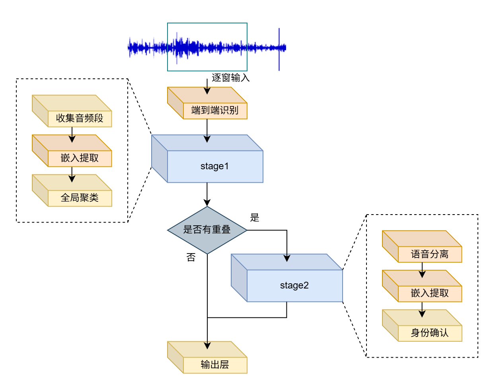

# RealtimeSD


基于 [pyannote/segmentation-3.0](<https://github.com/pyannote/pyannote-audio>) 与 [3D-Speaker/ERes2NetV2](<https://github.com/modelscope/3D-Speaker>) 的实时说话人识别（speaker diarization）管线。

## 项目内容

- 入口：`python3 run.py <音频文件>`（端到端一键编排：ASR 先就绪，再跑 diarization 管线与 viewer；`--stage {1,2,3}` 控制推进阶段）、`python3 -m diarization.app`（仅 diarization 阶段）、`python3 -m diarization.extract.app`（嵌入提取阶段）、`python3 -m diarization.cluster.app`（聚类阶段）、`python3 -m asr.app`（ASR 转写）、`python3 -m separation.app`（骨架：separation 暂不可独立运行，由 run.py `--stage >= 2` 驱动）
- 配置文件：`config/config.yaml`（diarization）、`config/asr.yaml`（ASR 转写）
- 管线实现：`diarization/`（extract + cluster）+ `separation/`（分段音频导出）+ `pipeline/`（组合层），模型代码统一在 `common/models/`
- 运行脚本：`run.py`（一键编排）、`test_der.py`（DER 评估）
- DER 评估：`tools/compute_der.py`
- 运行日志分析：`tools/analyze_log.py`
- 结果可视化：`viewer/`（波形 + ASR 时间线）

## 环境要求

- Python `>= 3.13`
- 建议 Linux + CUDA 环境
- 首次运行需要可访问 Hugging Face 和 ModelScope（当使用自动下载模型时）
- FFmpeg 4–8

## 安装

使用 `uv`：

```bash
uv sync
```

或使用 `pip`：

```bash
python3 -m venv .venv
source .venv/bin/activate
pip install -r requirements.txt
```

## 模型依赖

默认运行依赖：

- `ERes2NetV2`（说话人 embedding）
- `pyannote/segmentation-3.0`（局部说话人识别）
- `TIGER`（语音分离）
- `Fun-ASR-Nano`（ASR）

默认行为：

- 未提供 `--model_path`（或 `config/config.yaml` 里的 `model_path`）时，会自动下载并缓存默认 ERes2NetV2 到 `./pretrained/modelscope`
- segmentation 模型首次会下载并缓存到 `hf_cache_dir`（默认 `./pretrained/huggingface`）

`pyannote/segmentation-3.0` 需要 Hugging Face 授权。可通过环境变量提供 token：

```bash
export HF_TOKEN=your_token
```

## 快速开始

数据说明：音频数据不在版本库中（`datasets/` 见 `.gitignore`），需自行准备
任意 16kHz wav；模型 checkpoint 首次运行会自动下载到 `./pretrained/`，
无需手动准备。

单文件：

```bash
python3 run.py <音频.wav> \
  --config ./config/config.yaml \
  --run_name demo
```

常见覆盖参数：

```bash
python3 run.py <音频.wav> \
  --config ./config/config.yaml \
  --run_name demo \
  --model_path <本地 ckpt 路径> \
  --hf_cache_dir ./pretrained/huggingface \
  --device cuda:0 \
  --verbose
```

仅跑 diarization（不启动 ASR/viewer，跑完直接退出）：

```bash
python3 run.py <音频.wav> --stage 1 --no-viewer --no-wait
```

`--stage` 控制流水线推进到哪一阶段（累积式，默认 3 跑完整管线）：

- `--stage 1`：仅 diarization（RTTM 产物；等价于 `python3 -m diarization.app`）
- `--stage 2`：diarization + speech separation（导出分段音频）
- `--stage 3`：再加 ASR 转写（完整管线）

调试与可视化：

- `--debug`：输出调试信息
- `--show_rttm`：运行时把新写出的 RTTM 行同步打印到控制台

## 输出说明

输出目录按内容类型分子文件夹（`output_dir/` 下）：

```
output_dir/
  rttm/           # {uri}.raw.rttm（两后端统一；raw 级 append-only）
                  # {uri}.refined.rttm（两后端通用；修正与后处理后的最终输出）
                  # {uri}.speakers.json（refined 级 sidecar）
  segments/       # {uri}.segments.jsonl + {uri}/*.wav（仅 separation_enabled）
  transcripts/    # {uri}.transcript.jsonl（ASR 转写，run.py 编排时）
  embeddings/     # {uri}.chunks.npz（提取阶段 python3 -m diarization.extract.app 产出）
  logs/           # run.log、transcribe.log、viewer.log、command.log 等
```

## 脚本使用

基础运行：

```bash
python3 run.py <wav 文件>
```

运行时同步在控制台打印 RTTM：

```bash
SHOW_RTTM=1 python3 run.py <wav 文件>
```

带 DER 评估（需提供参考 RTTM 目录）：

```bash
REF_RTTM=<参考 rttm 目录> \
RUN_NAME=baseline \
python3 test_der.py <wav 文件>
```

`test_der.py` 也接受音频目录或每行一个路径的文本清单做批量评估：全部音频的
RTTM 写入同一输出目录（模型只加载一次），最后输出逐文件 DER 与拼接全局 DER：

```bash
python3 test_der.py datasets/task1-6 --ref_rttm datasets/task1-6/rttm --run_name task16
```

脚本常用环境变量（作为对应命令行参数的缺省值）：

- `CONFIG_PATH`
- `MODEL_PATH`
- `HF_TOKEN`
- `HF_CACHE_DIR`
- `OUTPUT_ROOT`
- `RUN_NAME`
- `DEBUG`
- `SHOW_RTTM`
- `STAGE`（流水线阶段 1/2/3，对应 `--stage`，默认 3）
- `ASR_CONFIG_PATH`（ASR 转写配置，默认 `./config/asr.yaml`）
- `WITH_VIEWER`（=0 时不启动结果可视化服务器）
- `VIEWER_PORT`（默认为 8000）
- `WAIT_VIEWER`（=0 时管线跑完不挂起等待 Ctrl+C，直接收尾退出）

以下环境变量仅 `test_der.py` 使用：

- `DEVICE`（运行设备覆盖，如 cpu/cuda）
- `REF_RTTM`（参考 RTTM 目录）
- `DER_VERBOSE`

脚本行为说明：

- 管线跑完后 `run.py` 不立即退出：打印"音频已处理完成"并挂起等待，
  viewer 保持可访问；按 Ctrl+C 后脚本退出并关闭 viewer（无人值守场景
  用 `--no-wait` / `WAIT_VIEWER=0` 跳过等待，跑完直接退出）

## 配置

参数在 `config/config.yaml`，全部参数的详细说明见 `config/README.md`。

## 仓库结构

- `diarization/`：说话人识别（extract + cluster 两级，chunk 管线）
- `separation/`：分段音频导出（commit 区重叠检测 + TIGER 分离 + 身份确认，接流式 ASR）
- `pipeline/`：组合层（runner：stage1+2 组合执行；follow：ASR 跟随编排；eval：DER 评估）
- `common/`：公共实现（`config/` 配置体系、`contracts/` 跨包契约、`utils/` 日志与编排辅助、`models/` 模型封装、路径常量）
- `speakerlab/`：3D-Speaker相关依赖与 `md-eval.pl`
- `look2hear`：TIGER相关依赖
- `tools`：常用工具，包括参数扫描，log分析等
- `run.py`：运行编排脚本（ASR + diarization + viewer）
- `asr/`：ASR模块
- `viewer/`：ASR 结果可视化
- `test_der.py`：DER 评估脚本

各模块（diarization / separation / asr / viewer）之间全部经共享输出目录的
文件交互（manifest / transcript / speakers.json sidecar / 哨兵），接口字段定义见各模块 README 的"文件交互接口"/"数据接口"章节。

## 备注

- 当前仓库偏实验性质，默认参数更贴近中文 16kHz 流式 diarization 场景
- 更细的模块说明与调参建议见各模块目录下的README
